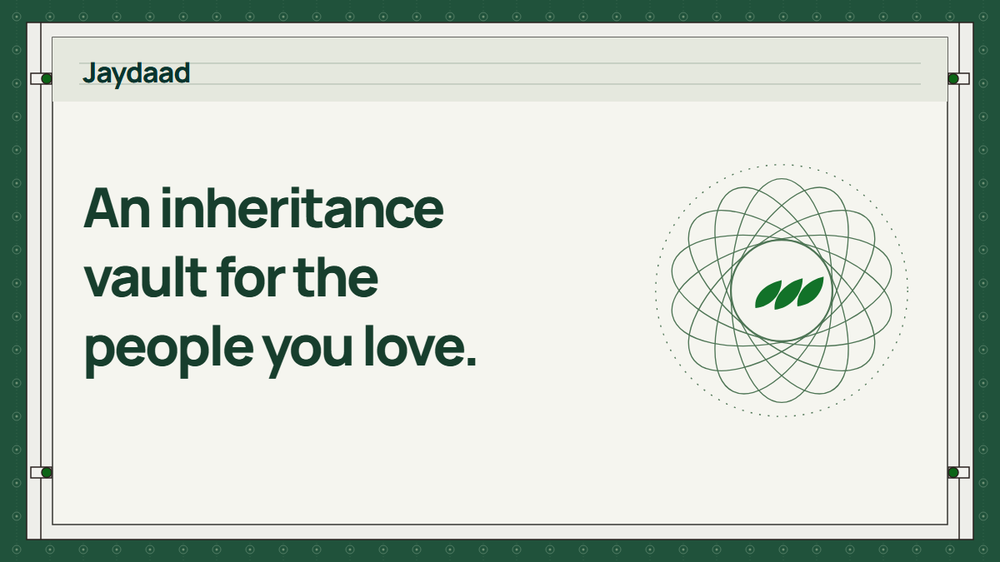

# Jaydaad

Jaydaad is a single-beneficiary inheritance vault for test QOR on QoreChain Diana. An owner checks in with an independent witness. If the owner misses the deadline, a grace period gives them time to check in again. Once grace expires, the beneficiary and witness can authorize a one-time payout.



## Run locally

Use Node.js 22.16 or later and npm.

```sh
npm ci
npm start
```

Open <http://127.0.0.1:4173>. You can inspect the configured vault without a wallet. Connect QoreX on Diana to fund an active vault with test QOR. The local server compiles the contract, bundles the dashboard, and provides read-only access to Diana. The CLI handles deployment and witnessed actions. [Diana setup and operations](docs/TESTNET.md)

## Using a vault

1. **Choose the participants.** The owner, beneficiary, and witness need distinct Diana addresses with possession-proven ML-DSA-87 keys. During setup, enter an EVM address or look up a QoreX handle and confirm the full address. The contract fixes all three roles at deployment.
2. **Activate and fund.** The first witnessed check-in starts the clock. QoreX can then send native test QOR to the vault. Jaydaad compares the amount and destination with the included transaction.
3. **Check in or settle.** A witnessed check-in restarts the interval. The owner and witness can cancel before the vault becomes claimable. After grace expires, the beneficiary and witness can claim the balance.
4. **Share private instructions.** On the Beneficiary page, choose **Create private handover note**. Supply the beneficiary’s signed QoreSeal recipient card. Jaydaad checks it against their registered encryption key and the signing key pinned by the vault, then encrypts the note in the browser. The beneficiary can open the file immediately. The contract’s timer governs the funds only. [Recipient setup and decryption](docs/TESTNET.md#private-handover-notes)

## Implementation

| Component | Role |
| --- | --- |
| QoreChain SDK and QoreX types | Native transfers, scoped EVM windows, wallet discovery, and signing requests |
| QoreChain PQC | ML-DSA-87 participant and witness approvals |
| Handles | Signed handle lookup and confirmation of beneficiary and witness addresses |
| QoreSeal | Hybrid encryption of off-chain handover notes for the designated beneficiary |
| Solidity and Hardhat | Vault lifecycle, authorization, and payout tests |

The vault binds each approval to its chain, contract, roles, timers, action, signer, nonce, and expiry. A native bank transfer credits the vault without invoking Solidity. If a transfer arrives after closure, the contract routes late recovery to the original payout recipient. [Vault contract](contracts/JaydaadEstate.sol) · [Threat model](docs/THREAT_MODEL.md)

## Development

| Command | Purpose |
| --- | --- |
| `npm run build` | Compile the Solidity contract and bundle the dashboard |
| `npm test` | Run contract, wallet, and integration checks |
| `npx playwright install chromium` | Install the browser used by the end-to-end suite |
| `npm run test:e2e` | Exercise the dashboard with controlled network and wallet responses |
| `npm run diana:check` | Read the Diana chain ID, registry, and PQ verifier |
| `npm run estate -- init` | Generate disposable role keys for a new local testnet configuration |

## Deployment records and limits

The [deployment manifest](deployments/diana.json) identifies the configured vault and records its state at the stated block. The dashboard reads its current state from Diana. A separate short-interval vault completed a 0.25 test QOR payout. The recorded funding used the CLI. [Payout accounting](deployments/payout-accounting.json) · [Public receipts](deployments/README.md)

Jaydaad runs on Diana testnet, chain ID 9800. Roles, balances, and deadlines are public. A missed check-in records inactivity. The witness is responsible for identifying the participant. Loss of a required key or witness can lock the funds. The local CLI can hold all three disposable identities on one device. This release has no published independent security audit.

## License

Jaydaad is distributed under the [MIT license](LICENSE). Third-party packages retain their respective licenses. The interface uses Manrope by Mikhail Sharanda, distributed through Fontsource under the SIL Open Font License.
