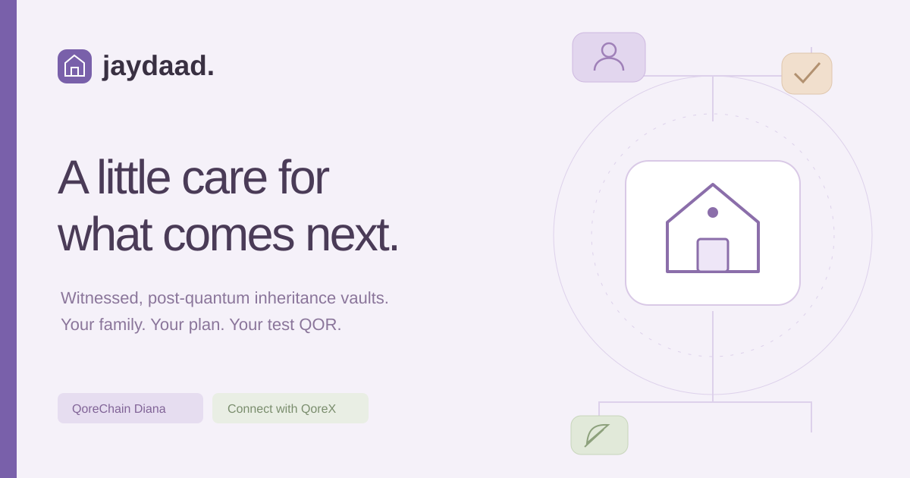

# Jaydaad

**A little care for what comes next.**



Jaydaad is a single-beneficiary inheritance vault for native **test QOR on
QoreChain Diana**. An owner checks in with an independent witness. A missed
check-in starts grace. The owner can return during grace; after it expires, the
beneficiary can claim once, with witness approval. Every sensitive action checks
both ML-DSA-87 signatures through QoreChain's real PQ verification interface.

The application has a responsive dashboard, vault creation and attachment,
beneficiary/witness records, check-ins, native QoreX funding, transaction receipt
verification, scoped-window controls, and public record exports. Every application read and transaction uses Diana.

## Run it

Node **22+** and npm are required.

```sh
npm ci
npm start
```

Open **<http://127.0.0.1:4173>**. The start command compiles Solidity locally and
bundles the frontend. The loopback server serves the UI and a read-only Diana gateway.
Connect the official QoreX extension on Diana for native funding. For the deployed
drill vault, use the dedicated role configuration for witnessed actions:

```sh
node scripts/diana-cli.js checkin --config .local/qday-2026/diana.json --vault 0xF98A128cc7764836c8E8c6c3EFBE5283cCea630D
```

## QoreX + testnet QOR

The browser uses **`@qorechain/qorex-types`**, EIP-6963 discovery, and
`window.qorex.native`. `signAndBroadcast` hands protobuf-encoded messages to
QoreX, which holds the keys, displays the request, adds the hybrid signature,
and broadcasts. Jaydaad never requests wallet secrets and never substitutes
another wallet for QoreX.

- **Funding:** native `MsgSend`, exact integer `uqor` amounts, and the vault's
  native address. A successful result is checked against the included Diana
  transaction, then the real vault balance is refreshed.
- **EVM scope:** the UI proposes 100 blocks, 3 transactions, a 1-QOR value-plus-fee
  cap, and only the verified vault as an allowed target. Open and close are native
  hybrid transactions. A window applies to the native account's matching 0x
  address, which may differ from QoreX's separately derived EVM account.
- **Network:** `qorechain-diana`, EVM ID **9800**. Mainnet is disabled.
- **Amounts:** native QOR uses 6 decimals (`uqor`); EVM values use 18. No USD
  pricing, pretend yield, or real-asset balances appear in this prototype.

**Current wallet boundary:** official QoreX documentation says current store
builds cannot send EVM transactions or sign arbitrary post-quantum application
messages. Native payments work through their supported provider. Deployments
and witnessed contract actions currently use the documented CLI with independent
role keys; the future-facing browser EVM path reports unsupported methods
explicitly. This is not claimed to be an already verified end-to-end QoreX EVM
experience. See the full [testnet runbook](docs/TESTNET.md).

## Commands

| Command | What it does |
| --- | --- |
| `npm start` | Compiles/bundles and serves the app on loopback. |
| `npm run build` | Creates Solidity ABI/bytecode and the browser bundle. |
| `npm test` | Runs contract tests on ephemeral Hardhat plus QOR/window-encoding tests. |
| `npx playwright install chromium` | Installs the browser for integration tests. |
| `npm run test:e2e` | Tests Diana UI and QoreX API behavior with an explicit wallet test double. |
| `npm run diana:check` | Read-only live check of chain ID, registry, and valid/altered ML-DSA verification. |
| `npm run estate -- init` | Creates ignored disposable role secrets and prints public faucet addresses. |
| `npm run estate -- bootstrap --register-keys` | After one faucet claim to the owner, funds the other roles by native transfer and enrolls their PQ keys. |
| `npm run deploy:diana -- --register-keys` | Explicitly enrolls fresh role keys and deploys through a bounded window. Requires funded Diana accounts. |
| `npm run estate -- --vault 0xADDRESS --action checkin` | Makes a participant-and-witness action through a vault-scoped window. |
| `npm run audit:prepare -- --stage stage-1` | Saves exact hashed input for the official QCAI auditor; does not perform an audit. |

## How the contract works

```text
Enrollment ── witnessed check-in ──> Active ── missed deadline ──> Grace
                                       ^                           │
                                       └── witnessed check-in ──────┤
                                                                   │ grace expires
                                                                   v
                                                               Claimable
                                                                   │ heir + witness
                                                                   v
                                                                Closed
Owner + witness can cancel before Claimable and return the full balance.
```

At creation, the owner, beneficiary, and witness must be distinct and have
possession-proven ML-DSA-87 registry keys. Their hashes are pinned. Each action
requires the correct EVM caller, that participant's PQ proof, and the witness's
different PQ proof. The live registry must still match each pinned key.

The message returned by `message()` binds the chain, estate, roles, both timers,
action, signer, nonce, and expiry. The contract increments the nonce before a
payout. Expired approvals, replays, early claims, wrong callers, revoked or
changed pinned keys, and forged witness approvals are rejected. Timers use
block time, with no keeper transaction or administrator key.

**Native funding detail:** a bank `MsgSend` bypasses Solidity `fund()`/`receive()`
and does not emit `Funded`. Its QOR is still in the contract's real balance and
included in payout. Native or forced deposits after closure can be recovered
only to the fixed original payout recipient, never the recovery caller.

## Evidence and hackathon fit

The [Post-Quantum dApp requirements](https://build.qorechain.io/) list scoped
EVM windows, `pqcVerify`, a two-stage QCAI audit, and Hardhat or Foundry tests.
This checkout includes code, test coverage, hashed audit-input preparation,
an MIT license, original cover art, an AI disclosure, and a timed demo script.

**Live deployment:** the primary Diana vault is
`0xF98A128cc7764836c8E8c6c3EFBE5283cCea630D`, active with **80 test QOR at migration**, a
30-day check-in interval, and 7-day grace. The app loads this deployment by
default. A separate 60-second/60-second vault at
`0x91E8E55A52113D2Fdc2c3f13d3fC5A735632D4A4` completed a witnessed **0.25-QOR
beneficiary payout** on the real testnet. No public time was fast-forwarded.

[Deployment manifest and verified receipts](deployments/diana.json),
[exact payout accounting](deployments/payout-accounting.json), and
[live read-only rejection checks](deployments/diana-security.json) preserve the
evidence. Native bank funding was hybrid-signed by the CLI; it is not claimed as
a real QoreX extension approval. Native wrapper hashes are included for EVM
transactions so the explorer and native receipt endpoint can find them.

**Still needed for a real submission:** real QoreX extension approval evidence,
both official QCAI reports, a public GitHub repo, the uploaded featured image,
and an actual video of at most three minutes. Official drill survival, a formal
audit, and a winning result are not claimed. See the
[submission packet](docs/SUBMISSION.md) for exact remaining items.

The local harness verifies genuine ML-DSA signatures with `@qorechain/pqc` and
records those verified tuples in a **test-only** precompile fixture. Contract
tests exercise the state machine; the separate Diana probe checks the real
network verifier. The browser wallet test double exercises API integration and
rejections, not actual extension signing or a public-chain broadcast.

## Limits

The witness must honestly identify the person and remain available. The demo
simulates that decision; there is no World ID, death detection, biometric, legal
probate, or impersonation-detection integration. Lost keys, witness loss, or
registry rotation can lock a vault because recovery/re-enrollment is unresolved.
Roles, balances, and timing are public. Only one beneficiary and native QOR are
supported. No ERC-20 accounting, private instructions, multi-heir splits, or
long-term cryptographic migration is implemented. Never deposit real assets.
Read the [threat model](docs/THREAT_MODEL.md) before relying on any security claim.

## Attribution and originality

The original project notes cited **Herit**, an ETHOnline project, as inspiration
for the opt-in inheritance lifecycle, grace window, and beneficiary claim:
[ETHGlobal showcase](https://ethglobal.com/showcase/herit-i56y4) and
[credited source snapshot](https://github.com/Kelechikizito/herit/tree/55115bf2c31c01c37387814c37d3e0baf8216717).
Jaydaad's QoreChain-specific witnessed contract, registry pinning, payload
format, wallet integration, UI, and test harness are separately implemented.
ENSv2 and World ID are not integrated. Preserve this attribution and describe
the event-period contribution honestly when submitting.

Libraries: QoreChain SDK, QoreChain PQC, and QoreX types (Apache-2.0); ethers
(MIT); CosmJS (Apache-2.0); Hardhat, solc, esbuild, and Playwright under their
respective licenses. Manrope is by Mikhail Sharanda, distributed through
Fontsource under the SIL Open Font License; the font is served locally. Original
SVG cover and UI illustrations are part of this MIT project. AI contributions
are disclosed in [AI_USAGE.md](AI_USAGE.md).

[QoreX integration docs](https://docs.qorechain.io/developer-tools/qorex-integrations)
· [EVM windows](https://docs.qorechain.io/developer-guide/evm-window-reference)
· [EVM precompiles](https://docs.qorechain.io/developer-guide/evm-precompiles)
· [Official rules](https://build.qorechain.io/rules)
